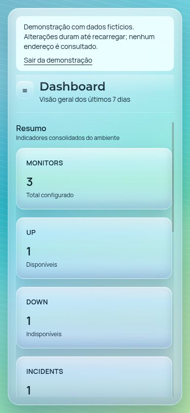

# PulseAPI Web

Frontend para o backend PulseAPI, oferecendo um painel web para monitoramento de endpoints HTTP. A interface é inspirada em Frutiger Aero com glassmorphism, gradientes suaves e foco em legibilidade operacional.

## Visitar sem cadastro

Na [interface publicada](https://pulseapi-web.vercel.app), use **Visitar demonstração sem cadastro**. O link direto é `/dashboard?demo=1`.

A demonstração usa somente dados fictícios no navegador. Consultas, rechecks, novos monitores e reconhecimento de alertas são simulados; nenhum endpoint informado é acessado e as alterações desaparecem ao recarregar. O aviso permanece visível e “Sair da demonstração” retorna ao login normal. O modo é opt-in, nunca um fallback silencioso de uma API indisponível. A publicação depende do deploy do commit que contém essa funcionalidade.

Para avaliar a integração real, execute o [backend Java](https://github.com/EduardoPaim5/pulseapi) e siga a configuração abaixo. O antigo endereço Railway não está confirmado como disponível.

### Capturas da demonstração


<details><summary>Ver em tela móvel</summary>



</details>

## O que este projeto faz
- Autenticação (login e registro).
- Dashboard com totais, alertas recentes e piores monitores.
- Gestão de monitores com recheck manual.
- Visualização de métricas por janela (24h, 7d, 30d).
- Lista de alertas com fluxo de acknowledge.

## Arquitetura
- React + TypeScript com roteamento via React Router.
- Camada de API com Axios e interceptors.
- Cache e sincronização de dados via TanStack Query.
- Componentes UI próprios e Tailwind CSS para estilo.

## Tech Stack
- Vite + React + TypeScript
- Tailwind CSS
- React Router
- TanStack Query
- Axios
- Recharts

## Requisitos
- Node.js 20 LTS (ou superior)
- API PulseAPI disponível (local ou Railway)

## Configuração
1. Instale dependências:
```bash
npm install
```

2. Configure a base URL da API:
```bash
cp .env.example .env
```

Edite `.env` com o endereço do backend que você executou:
```
VITE_API_BASE_URL=http://localhost:8080
```

3. Inicie o app:
```bash
npm run dev
```

## Scripts
- `npm run dev` inicia o ambiente local.
- `npm run build` gera a build de produção.
- `npm run preview` pré-visualiza a build localmente.
- `npm test` roda os testes (Vitest).

## Deploy (Vercel)
1. Crie um novo projeto e conecte este repositório.
2. Configure a variável `VITE_API_BASE_URL`.
3. Faça o deploy.
4. O projeto publica headers de segurança via `vercel.json` (CSP, HSTS, X-Frame-Options e outros).

## Observações
- A UI usa apenas endpoints documentados pelo backend PulseAPI.
- O access token fica apenas em memória; refresh token usa cookie HttpOnly no backend.
